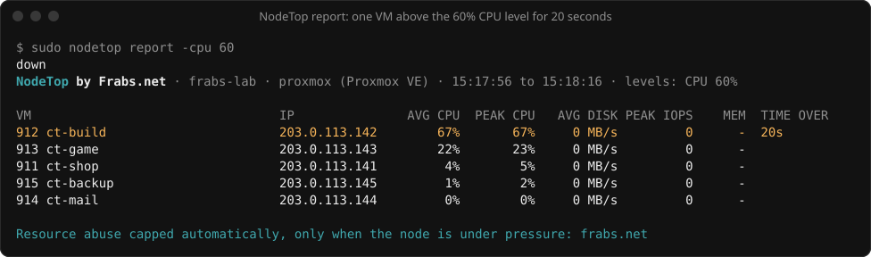

# NodeTop

**See what every VM on your hypervisor uses of it, and which ones stay above your levels.**
Made by [Frabs.net](https://frabs.net) · Apache-2.0



NodeTop is a small command-line tool for hosting providers. Run it on a
hypervisor and it shows, per VM, how much of its own vCPUs it is using, how
hard it is hitting the disk, and how much memory it holds. Set a level and
NodeTop shows which VMs are above it, and for how long.

It only shows. It never limits, pauses or touches a VM.

## Install

A single static binary for Linux (amd64 and arm64). There is nothing to
configure.

```
go install github.com/frabsnet/nodetop/cmd/nodetop@latest
```

or download a release from the
[releases page](https://github.com/frabsnet/nodetop/releases/latest), or build
from source:

```
git clone https://github.com/frabsnet/nodetop
cd nodetop
CGO_ENABLED=0 go build -trimpath -o nodetop ./cmd/nodetop
sudo install nodetop /usr/local/bin/
```

## Usage

```
nodetop                              live dashboard
nodetop -cpu 80 -disk 200            highlight VMs above 80% CPU or 200 MB/s of disk
nodetop report                       measure for 60 seconds, then print a summary
nodetop report -duration 10m -format csv -o report.csv
nodetop vms                          list the VMs NodeTop found
```

Levels (0 turns one off):

| Option | Means | Default |
|---|---|---|
| `-cpu` | % of the VM's own vCPUs | 90 |
| `-disk` | disk MB/s, reads and writes together | off |
| `-iops` | disk operations per second | off |
| `-mem` | % of the VM's allocated memory | off |

Dashboard keys: `↑` `↓` select, `s` change sort (CPU, disk, IOPS, memory, time
over), `/` search by VM ID, name or IP, `p` pause, `q` quit.

Run it as root: control groups are only readable by root on most hosts.

## Supported platforms

| Platform | How VMs are found and measured |
|---|---|
| Proxmox VE (KVM) | `/etc/pve/qemu-server`, the VM's `qemu.slice/<vmid>.scope` |
| Proxmox VE (LXC) | `/etc/pve/lxc`, the container's `lxc/<ctid>` group |
| libvirt / KVM | running domains, the VM's `machine-qemu-…scope` |
| Virtualizor, VirtFusion, SolusVM | through libvirt; the panel is detected and shown |

cgroup v1 and v2 both work. Xen guests are listed but cannot be measured
this way, and are shown with dashes.

## How it works

- **CPU** comes from each VM's `cpu.stat` (`cpuacct.usage` on cgroup v1),
  shown as a share of the VM's own vCPUs, read from QEMU's `-smp` or the
  container's CPU allowance.
- **Disk** comes from `io.stat` (`blkio` on cgroup v1): bytes and operations,
  reads and writes.
- **Memory** is `memory.current` against the VM's allocated memory.

NodeTop reads hypervisor configuration and control groups, never anything
inside a VM, and changes nothing on the host.

## NodeTop and Frabs

NodeTop shows you who is using what on one server, right now, and leaves the
deciding to you. [Frabs](https://frabs.net) watches every node around the
clock and caps a VM that hogs CPU or disk for hours, only when the node itself
is under pressure, and lifts the cap the moment it calms down.

## Licence

Apache License 2.0. Copyright 2026 Frabs.
